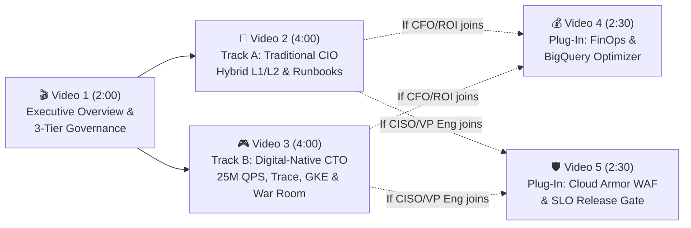

# 🎬 Presales Modular Demo Playbook, Live Testing Guide & Word-for-Word Teleprompters

This end-to-end playbook walks you through:
1. **Spinning Up the Live Terraform Environment** (including **Multi-Region GKE Clusters** in `us-central1` & `us-east1`, Hybrid Networking, Global Load Balancer, Cloud Run Canary Splits, BigQuery, and seeded faults).
2. **Testing Every Leadership Pointer Live** using the new built-in **`🎯 Presales Persona Mode` Switcher** on `http://localhost:8080` (powered by **Vertex AI Gemini 3.1 Pro**) and the **Built-In Live SRE ChatOps War Room (`http://localhost:8080/war-room`)**.
3. **Recording the 5 Modular Presales Videos** with word-for-word teleprompter scripts and tab-by-tab visual choreography.
4. **Deleting / Tearing Down the Complete Environment** (`./cleanup_agent_and_demo_resources.sh`) so zero GCP resources remain billing after your demo.

---

## 🚀 1. How to Get the Demo Environment Up (Step-by-Step)

### Step 1A: Authenticate Google Cloud CLI & Application Default Credentials
Open **Terminal Tab 1** and ensure `gcloud` and Python ADC point to your demo project (e.g., `jllnetworkhub`):
```bash
export GOOGLE_CLOUD_PROJECT="jllnetworkhub"
gcloud config set project "${GOOGLE_CLOUD_PROJECT}"
gcloud auth application-default set-quota-project "${GOOGLE_CLOUD_PROJECT}"
```

### Step 1B: Provision the Full Terraform Sandbox (Includes Multi-Region GKE!) & Seed Live Faults
Run the single provision-and-seed script inside [`demo_sandbox/`](file:///Users/psabhishek/Documents/Projects/cloudopsagentjapan/demo_sandbox/provision_and_seed_demo.sh):
```bash
cd /Users/psabhishek/Documents/Projects/cloudopsagentjapan/demo_sandbox
./provision_and_seed_demo.sh "${GOOGLE_CLOUD_PROJECT}" us-central1
```
**What this provisions & seeds automatically (~5–7 minutes on first run for Multi-Region GKE):**
- **Multi-Region GKE Autopilot Fleet (Persona 2):**
  - Primary GKE Cluster **`game-streaming-gke-cluster` (`us-central1`)** seeded with live Kubernetes `Deployment/game-matchmaking-frontend` (`3` replicas).
  - Failover GKE Cluster **`game-streaming-gke-failover` (`us-east1`)** seeded with live Kubernetes `Deployment/game-matchmaking-frontend` (`1` warm standby replica, ready for container relocation).
- **Global External Application Load Balancer (Persona 2):** `game-streaming-global-lb` + `game-streaming-edge-backend` routing across `us-central1` and `us-east1` (intentionally missing Cloud Armor WAF).
- **4-Hop Distributed Cloud Traces (Persona 2):** 3 live `1,480 ms` waterfall traces (`Client Edge LB → Frontend GKE → Backend GKE → Spanner/Redis`) + correlated `25.4M QPS` & `OOMKilled` logs.
- **Hybrid Enterprise Networking & Banking Service (Persona 1):** `cloudops-hybrid-demo-vpc`, `cloudops-hybrid-bgp-router` (`ASN 64514`), `cloudops-hybrid-havpn-gw`, `cloudops-enterprise-hybrid-hub` (NCC), and **`core-banking-ledger`** seeded with an **`80% stable / 20% canary`** split plus VMware, Bare Metal, Oracle `ORA-00060`, AWS EC2, and BGP flap logs.
- **FinOps, SecOps & Release Targets:** Orphaned `50 GB` disk, unused static IP, `checkout-api` (`min-instances=1` + `80/20` canary split), unpartitioned BigQuery table + `SELECT *` jobs, open-posture GCS bucket, and unrotated Secret Manager secret (`cloudops-demo-oracle-db-password`).

### Step 1C: Start the Agent & Live SRE War Room Server
Open **Terminal Tab 2** and launch the FastAPI server ([`app.py`](file:///Users/psabhishek/Documents/Projects/cloudopsagentjapan/app.py)):
```bash
cd /Users/psabhishek/Documents/Projects/cloudopsagentjapan
source .venv/bin/activate
export GOOGLE_CLOUD_PROJECT="jllnetworkhub"
uvicorn app:app --reload --port 8080
```
Open **`http://localhost:8080`** (press **`Cmd + Shift + R`** once to ensure fresh UI) and **`http://localhost:8080/war-room`** in Chrome at **`125%` zoom**.

---

## ✅ 2. How to Test All Leadership Pointers on the Provisioned Environment

Before recording, walk through these **3 quick checks** to verify every leadership comment on your live Terraform environment:

### Test A: Verify Simplified Visual UI, `Gemini 3.1 Pro` Label & Presales Persona Mode Switcher
1. Open **`http://localhost:8080`**.
2. Confirm the top navbar cleanly displays **`Vertex AI Gemini 3.1 Pro Online`** (no `-preview` suffix) alongside **`💬 Live SRE War Room`**.
3. At the top of the page, click through the **4-button `🎯 Presales Persona Mode` Switcher Bar** (no Chrome DevTools snippets needed!):
   - **`✨ 1. Executive Overview`**: Clean, clutter-free landing view showing only the 4 KPI cards, 3-Tier Maturity Stepper, 6-Sub-Agent Squad Roster, and Execution Console.
   - **`🏦 2. Traditional Enterprise CIO`**: Spotlights **only** the Traditional Enterprise CIO card with 3 scannable capability chips and hides all Gaming/GKE/27-button clutter.
   - **`🎮 3. Digital-Native CIO / CTO`**: Spotlights **only** the Digital-Native CTO card (`25M QPS · Multi-Region GKE`) and hides all legacy VMware/Oracle clutter.
   - **`🛠️ 4. Full Platform (All 6 Domains)`**: Expands FinOps, SecOps, DBA, Release, and all 27 domain presets when needed.
   *(Tip: You can also open direct URLs like `http://localhost:8080/?mode=cio` or `http://localhost:8080/?mode=cto`!)*

### Test B: Test Leadership Pointer — Traditional Enterprise CIO (Hybrid L1/L2, Runbooks & Rollback)
1. Click **`🏦 2. Traditional Enterprise CIO`** in the top Presales Persona Mode bar.
2. Select **`Level 2 Maturity (Human-in-the-Loop)`**, click **`▶️ Launch Hybrid L1/L2 Triage, VMware/Oracle/AWS/BGP Correlation & Runbook`**, and click **`⚡ Execute Agentic Day-2 Ops Task`**.
   - **Verify:** Agent correlates VMware `vSAN` (`54.2ms`), Bare Metal HBA, Oracle `ORA-00060`, AWS EC2 (`i-0a9f82c41e3b7d102`), and Cloud Router BGP (`169.254.10.1`), classifies L1 vs. L2 toil, and registers **`cloudops-hybrid-runbook-core-banking-ledger`** in staged mode.
3. Switch to **`Level 3 Maturity (Autonomous Closed-Loop)`**, click **`🔄 Execute Automated Cloud Workflow Runbook & 100% Stable Rollback`**, and click **`⚡ Execute`**.
   - **Verify Live in GCP Console:**
     - **Cloud Workflows:** `https://console.cloud.google.com/workflows?project=jllnetworkhub` → `cloudops-hybrid-runbook-core-banking-ledger` is `ACTIVE` with a `SUCCEEDED` execution!
     - **Cloud Run Revisions:** `https://console.cloud.google.com/run/detail/us-central1/core-banking-ledger/revisions?project=jllnetworkhub` → traffic shifted from `80% / 20%` to **`100% core-banking-ledger-00001-stable`**!

### Test C: Test Leadership Pointer — Digital-Native CIO/CTO (25M QPS, Trace, LB Shedding, Multi-Region GKE Relocation & War Room)
1. Click **`🎮 3. Digital-Native CIO / CTO`** in the top Presales Persona Mode bar.
2. Select **`Level 2 Maturity`** (to demonstrate interactive War Room approval) or **`Level 3 Maturity`** (for immediate autonomous execution), click **`▶️ Launch 25M QPS E2E Trace, LB Shedding, Multi-Region GKE Relocation & War Room`**, and click **`⚡ Execute`**.
3. Open **`http://localhost:8080/war-room`** (or click **`💬 Live SRE War Room`** in the navbar):
   - **Verify in War Room:** The **`🚨 Autonomous Anomaly Diagnosis: game-matchmaking-frontend`** interactive card appears live in `#sre-high-qps-war-room`. Click **`⚡ Shed Traffic at Global LB & Attach WAF`** and **`☸️ Relocate Containers & Scale us-east1`** right inside the War Room chat card to watch live **`✅ EXECUTED_IN_GCP`** thread confirmations appear!
   - **Verify Live in GCP Console:**
     - **Cloud Trace Waterfall:** `https://console.cloud.google.com/traces/list?project=jllnetworkhub` → shows the 4-hop `1.48s` trace waterfall (`Client LB → Frontend GKE → Backend GKE → Spanner`).
     - **GKE Workloads (Multi-Region Container Relocation!):** `https://console.cloud.google.com/kubernetes/workload/overview?project=jllnetworkhub` → `game-matchmaking-frontend` on **`game-streaming-gke-cluster` (`us-central1`)** drained down to **`1` replica**, while **`game-streaming-gke-failover` (`us-east1`)** scaled up to **`6` replicas**!
     - **Global Load Balancing:** `https://console.cloud.google.com/net-services/loadbalancing/list/loadBalancers?project=jllnetworkhub` → `game-streaming-edge-backend` primary `capacityScaler` patched live to shed load to `us-east1`.
     - **Cloud Armor WAF:** `https://console.cloud.google.com/net-security/securitypolicies/list?project=jllnetworkhub` → `cloudops-waf-game-streaming-edge-backend` active with **Priority `1000` (Rate-Limit)** & **Priority `2000` (OWASP SQLi/XSS)** attached to `game-streaming-edge-backend`.
     - **Notification Channels:** `https://console.cloud.google.com/monitoring/alerting/notifications?project=jllnetworkhub` → `CloudOps SRE ChatOps War Room (#sre-high-qps-war-room)` registered under Webhooks.

> [!TIP]
> **Resetting State Before Recording After Testing:**
> After running Test B & Test C, simply re-run `python demo_sandbox/seed_demo_telemetry_and_faults.py --project jllnetworkhub --region us-central1` (takes ~20 seconds) to reset the `80/20` canary splits and GKE replica counts (`3` in `us-central1`, `1` in `us-east1`) cleanly before hitting Record!

---

## 🧩 3. Modular Presales Video Strategy (5 Short "Lego-Block" Videos)

Instead of one 20-minute monolithic recording, record **5 modular videos (2–4 minutes each)** that presales teams mix-and-match per meeting:



| Video # | Title & Target Persona | UI Mode Button to Click | Length | When Presales Plays It |
| :--- | :--- | :--- | :---: | :--- |
| **Video 1** | **Executive Overview & 3-Tier Governance** | `✨ 1. Executive Overview` | **2:00** | **Universal opener** for the first 2 mins of any CxO call. |
| **Video 2** | **Track A: Traditional Enterprise CIO** | `🏦 2. Traditional Enterprise CIO` | **4:00** | **Manufacturing / Banking / Retail CIOs:** L1/L2 toil cut, VMware/Bare Metal/Oracle/AWS/BGP correlation & Cloud Workflows rollback. |
| **Video 3** | **Track B: Digital-Native CIO/CTO** | `🎮 3. Digital-Native CIO / CTO` | **4:00** | **Gaming / Media / Streaming CTOs:** 25M QPS surge, 4-hop Trace waterfall, LB shedding, Multi-Region GKE relocation & Live SRE War Room. |
| **Video 4** | **Plug-In A: FinOps & BigQuery Optimizer** | `🛠️ 4. Full Platform` | **2:30** | **CFO / ROI Q&A:** Idle waste hunting & BigQuery SQL/partitioning savings. |
| **Video 5** | **Plug-In B: SecOps WAF & SLO Gate** | `🛠️ 4. Full Platform` | **2:30** | **CISO / VP Eng Q&A:** Cloud Armor WAF, secret rotation, Terraform PRs & SLO release gates. |

---

# 🎙️ 4. Word-for-Word Teleprompter Scripts (All 5 Modular Videos)

*(Camera Rule: Keep Chrome at `125%` zoom, speed up 15s tool-calling spinners `4×` in post-edit, and spend **70% of screen time** on visual GCP Console graphs and the Live SRE War Room!)*

---

## 🎬 VIDEO 1: Universal Executive Opener & 3-Level Governance (`02:00`)
- **UI Mode Selected:** **`✨ 1. Executive Overview`** on `http://localhost:8080`

### 🖥️ [00:00 – 00:45] Scene 1.1: The Day-2 Problem & Outcome KPIs
- **On-Screen Action:** Frame the clean top navbar (`Vertex AI Gemini 3.1 Pro Online` + `💬 Live SRE War Room`), the `🎯 Presales Persona Mode` bar on `✨ 1. Executive Overview`, and the **4 KPI boxes**.
- **🎙️ TELEPROMPTER (Read Word-for-Word):**
  > *"When enterprises move to the cloud, migration is only Day 1. Up to **70% of operational cost, outage risk, and engineering burnout happens on Day 2**.*
  >
  > *Operations teams are buried under alert storms, fragmented hybrid and Kubernetes telemetry, surprise cloud spend, and manual 2:00 AM runbooks.*
  >
  > *Standard AI chatbots only summarize documentation. What you see here is our **Google Cloud Agentic Day-2 Operations Command Center**, powered by **Vertex AI Gemini 3.1 Pro** and the **Google Agent Development Kit**.*
  >
  > *Instead of a single chatbot, a **Root Supervisor Agent** coordinates **six domain-specialist sub-agents** connected directly to **42 live Google Cloud and Kubernetes APIs**—cutting repetitive operational toil and Mean Time to Resolution by **up to 60%**."*

### 🖥️ [00:45 – 01:35] Scene 1.2: The Enterprise Trust Unlock — 3-Level Maturity Governance
- **On-Screen Action:** Frame the compact **3-Level Maturity Stepper** and **6-Agent Squad Roster**. Click **Level 1**, **Level 2**, and **Level 3** as you name each tier.
- **🎙️ TELEPROMPTER (Read Word-for-Word):**
  > *"Every technology leader asks the same question first: **'How do we adopt autonomous AI safely without risking production?'***
  >
  > *That is why governance is enforced directly across **three progressive maturity levels**:*
  >
  > *At **Level 1—AI-Assisted Diagnosis**, the agent is **100% read-only**. It correlates live logs, traces, network state, and commits in seconds, and outputs verified CLI, `kubectl`, and Terraform runbooks. Zero production mutations.*
  >
  > *At **Level 2—Human-in-the-Loop Approval**, our recommended enterprise default, the agent automatically provisions safe observability—dashboards, alerts, SLOs, and ChatOps webhooks—while **staging** high-impact rollbacks or traffic shifts for one-click human sign-off.*
  >
  > *And at **Level 3—Autonomous Closed-Loop**, for pre-approved scenarios like canary rollbacks or massive traffic spikes, the agent executes self-healing remediation automatically in under two minutes."*

### 🖥️ [01:35 – 02:00] Scene 1.3: Segue to Persona Track
- **On-Screen Action:** Point cursor across **`🏦 2. Traditional Enterprise CIO`** and **`🎮 3. Digital-Native CIO / CTO`** in the top Presales Persona Mode bar.
- **🎙️ TELEPROMPTER (Read Word-for-Word):**
  > *"Whether you are a **CIO modernizing complex hybrid enterprise infrastructure** or a **CTO running multi-region GKE at tens of millions of queries per second**, the platform adapts to your priorities. Let's see it in live action."*

---

## 🏭🏦 VIDEO 2 (FLAGSHIP TRACK A): Traditional Enterprise CIO (`04:00`)
- **UI Mode Selected:** Click **`🏦 2. Traditional Enterprise CIO`** on `http://localhost:8080`
- **Adjacent Tabs Ready:** Cloud Workflows Console + Cloud Run `core-banking-ledger` Revisions (`80% stable / 20% canary`)

### 🖥️ [00:00 – 00:45] Scene 2.1: Framing the Hybrid Enterprise CIO Challenge
- **On-Screen Action:** Show the clean **`🏦 CIO — Traditional Enterprise`** card on `http://localhost:8080`, then flash the **`core-banking-ledger` Cloud Run Revisions** tab (`80% stable / 20% canary`).
- **🎙️ TELEPROMPTER (Read Word-for-Word):**
  > *"In a traditional enterprise—such as banking or global manufacturing—mission-critical systems rarely live in a single cloud-native silo.*
  >
  > *A single transaction on **`core-banking-ledger`** spans **on-premise VMware and Bare Metal servers**, **Oracle databases**, **workloads in AWS**, and **Google Cloud** over **Cloud Interconnect and BGP VPNs**.*
  >
  > *When a slowdown hits after a deployment, L1 and L2 operations teams spend hours in war rooms manually stitching together logs across four different silos—driving up operational toil and Mean Time to Resolution.*
  >
  > *Let's watch our Agentic Operations Center resolve this live cross-hybrid incident."*

### 🖥️ [00:45 – 02:15] Scene 2.2: Autonomous L1/L2 Triage & Cross-Hybrid Correlation (Level 2 HITL)
- **On-Screen Action:**
  1. Ensure **`Level 2 Maturity (Human-in-the-Loop)`** is active.
  2. Click **`▶️ Launch Hybrid L1/L2 Triage, VMware/Oracle/AWS/BGP Correlation & Runbook`**, then click **`⚡ Execute Agentic Day-2 Ops Task`**.
  3. Point to **`🚨 Incident & Hybrid`** lighting up green in the Squad Roster, and highlight the **Hybrid Correlation Summary Table** + **`WORKFLOW_REGISTERED_AND_STAGED_FOR_APPROVAL`** status.
- **🎙️ TELEPROMPTER (Read Word-for-Word):**
  > *"We start in **Level 2—Human-in-the-Loop Governance**—and launch our hybrid triage workflow for `core-banking-ledger`.*
  >
  > *Notice **Gemini 3.1 Pro** immediately dispatches our **Incident and Hybrid Specialist Sub-Agent**.*
  >
  > *Within seconds—without a human opening five consoles—the agent correlates live telemetry across every hybrid tier in a single pass:*
  > - *On-premise, it flags a **VMware ESXi `vSAN` latency spike** and **Bare Metal Fibre Channel link degradation**.*
  > - *In the database tier, it catches an **Oracle `ORA-00060` deadlock**.*
  > - *Across clouds and hybrid networking, it correlates an **AWS EC2 gateway timeout** with a **Cloud Router BGP peer session flap** on our HA VPN tunnel—plus a faulty canary commit.*
  >
  > *It deduplicates the alert storm by **over 60%**, separates **L1 auto-healable issues** from **L2 engineering escalations**, registers our **`cloudops-hybrid-runbook-core-banking-ledger`** workflow in Google Cloud, and pauses safely for human sign-off."*

### 🖥️ [02:15 – 03:35] Scene 2.3: Automated Runbook Execution & Live Self-Healing Rollback (Level 3)
- **On-Screen Action:**
  1. Click **`Level 3 Maturity (Autonomous Closed-Loop)`**, click **`🔄 Execute Automated Cloud Workflow Runbook & 100% Stable Rollback`**, and click **`⚡ Execute`**.
  2. Switch immediately to **Cloud Workflows Console** → click **`cloudops-hybrid-runbook-core-banking-ledger` → Executions** showing **`SUCCEEDED`** with the visual workflow graph!
  3. Switch to **Cloud Run `core-banking-ledger` Revisions Console** → refresh on camera to show the green traffic bar shifting from **`80% / 20%` → `100% core-banking-ledger-00001-stable`**!
- **🎙️ TELEPROMPTER (Read Word-for-Word):**
  > *"Now let's see what happens upon human approval—or when recurring L1 runbooks run in **Level 3 Autonomous Mode**.*
  >
  > *Let's switch directly to the **live Google Cloud Console**:*
  >
  > *First, inside **Google Cloud Workflows**, the agent automatically deployed and executed **`cloudops-hybrid-runbook-core-banking-ledger`**—verifying hybrid router state and application health with status **`SUCCEEDED`**.*
  >
  > *Second, inside **Cloud Run Revisions for `core-banking-ledger`**, watch the live traffic bar as I refresh: the agent automatically rolled back the faulty canary deployment, restoring **100% of production banking traffic** to the stable revision."*

### 🖥️ [03:35 – 04:00] Scene 2.4: CIO Business Outcome Wrap-Up
- **On-Screen Action:** Return briefly to the KPI bar on `http://localhost:8080`.
- **🎙️ TELEPROMPTER (Read Word-for-Word):**
  > *"For a Traditional Enterprise CIO, the outcome is clear: **60% less L1 and L2 alert toil**, single-pane correlation across **VMware, Bare Metal, Oracle, AWS, and Google Cloud**, and **MTTR compressed from hours to under two minutes**."*

---

## 🎮📺 VIDEO 3 (FLAGSHIP TRACK B): Digital-Native CIO / CTO (`04:00`)
- **UI Mode Selected:** Click **`🎮 3. Digital-Native CIO / CTO`** on `http://localhost:8080`
- **Adjacent Tabs Ready:** `http://localhost:8080/war-room`, Cloud Trace Explorer, GKE Workloads Console, Global Load Balancing, Cloud Armor, and Notification Channels

### 🖥️ [00:00 – 00:45] Scene 3.1: Framing the 10M+ QPS Multi-Region GKE Spike
- **On-Screen Action:** Show the clean **`🎮 CIO / CTO — Digital-Native (`25M QPS · Multi-Region GKE`)`** card on `http://localhost:8080`, then flash **GKE Workloads Console** (`https://console.cloud.google.com/kubernetes/workload/overview?project=jllnetworkhub`) showing `game-matchmaking-frontend` running across **`game-streaming-gke-cluster` (`us-central1`, `3` pods)** and **`game-streaming-gke-failover` (`us-east1`, `1` pod)**.
- **🎙️ TELEPROMPTER (Read Word-for-Word):**
  > *"For digital-native gaming, live broadcast, and streaming platforms operating at **10 to 25 million queries per second** across multi-cluster, multi-region GKE, reactive alerting is already too slow.*
  >
  > *When a global live broadcast spikes traffic by 5x in sixty seconds, waiting fifteen minutes for an engineer to wake up, inspect dashboards, and manually shift capacity means millions of dropped streams.*
  >
  > *You need **autonomous, deterministic incident mitigation in real time**—integrated directly into your SRE **ChatOps war room**. Here we have two live GKE clusters in **`us-central1`** and **`us-east1`** experiencing a **25-million-QPS surge**."*

### 🖥️ [00:45 – 01:55] Scene 3.2: E2E 4-Hop Log & Trace Correlation (`Client → FE → BE → DB`)
- **On-Screen Action:**
  1. Show **Cloud Trace Explorer** clicking into one `HTTP POST /v2/live-broadcast/matchmaking-state` (`1.48s`) **4-span visual waterfall**.
  2. Switch to `http://localhost:8080` (`Level 2 Maturity` selected), click **`▶️ Launch 25M QPS E2E Trace, LB Shedding, Multi-Region GKE Relocation & War Room`**, and click **`⚡ Execute`**.
  3. Point briefly to **`📈 High-QPS GKE`**, **`🚨 Incident & Hybrid`**, and **`🛡️ SecOps & WAF`** lighting up green in the Squad Roster, and highlight the concise **4-Hop Bottleneck Table**.
- **🎙️ TELEPROMPTER (Read Word-for-Word):**
  > *"Look at the **Cloud Trace waterfall** during our live broadcast spike: end-to-end latency just jumped to **1.48 seconds** with edge `HTTP 503` errors.*
  >
  > *Instead of grepping millions of log lines, **Gemini 3.1 Pro** joins **Cloud Trace spans with structured logs end-to-end across all four hops**:*
  > - *From **Client Edge Load Balancer**,*
  > - *Through **Frontend GKE Ingress**,*
  > - *Into our **Backend GKE Matchmaking pods**—catching **98.7% CPU CFS throttling** and `OOMKilled` container restarts in `us-central1`,*
  > - *All the way down to **Cloud Spanner lock contention (`1,140 ms`) and Redis pool saturation**.*
  >
  > *In Level 2 Governance, it registers a live **Google Cloud Monitoring ChatOps Webhook** and posts an interactive mitigation card straight into our **SRE War Room**."*

### 🖥️ [01:55 – 03:00] Scene 3.3: Live SRE ChatOps War Room (`/war-room`) & 1-Click Deterministic Mitigation
- **On-Screen Action:**
  1. Switch to **`http://localhost:8080/war-room`**! Point to the newly arrived **`🚨 Autonomous Anomaly Diagnosis: game-matchmaking-frontend`** card in `#sre-high-qps-war-room`.
  2. Click the red **`⚡ Shed Traffic at Global LB & Attach WAF`** button AND the blue **`☸️ Relocate Containers & Scale us-east1`** button right inside the War Room chat thread! Watch the two green **`✅ EXECUTED_IN_GCP`** thread replies appear live!
- **🎙️ TELEPROMPTER (Read Word-for-Word):**
  > *"Let's open our **Live SRE ChatOps War Room**—connected to Google Cloud Monitoring's webhook bus.*
  >
  > *Right inside **`#sre-high-qps-war-room`**, engineers see the correlated 4-hop root cause alongside **one-click deterministic mitigation actions**.*
  >
  > *Watch what happens when I click **`Shed Traffic at Global LB & Attach WAF`** and **`Relocate Containers & Scale us-east1`** right inside the war room thread:*
  >
  > *The agent executes both deterministic loops directly against Google Cloud and our live GKE Kubernetes APIs—posting instant verification back into the thread!"*

### 🖥️ [03:00 – 04:00] Scene 3.4: Visual Proof Across GKE Workloads, Global Load Balancer & Cloud Armor
- **On-Screen Action:**
  1. Switch to **GKE Workloads Console** (`https://console.cloud.google.com/kubernetes/workload/overview?project=jllnetworkhub`) and refresh on camera: show `game-matchmaking-frontend` drained to **`1` pod** in saturated `game-streaming-gke-cluster` (`us-central1`) and scaled up to **`6` pods** in healthy `game-streaming-gke-failover` (`us-east1`)!
  2. Flash **Global Load Balancing (`game-streaming-edge-backend`)** showing primary `capacityScaler` shed to `us-east1`, and **Cloud Armor (`cloudops-waf-game-streaming-edge-backend`)** showing **Priority `1000` Rate-Limiting** + **Priority `2000` OWASP WAF** attached live!
- **🎙️ TELEPROMPTER (Read Word-for-Word):**
  > *"And let's verify all three live mutations in the **Google Cloud Console**:*
  >
  > *First, in **Google Kubernetes Engine Workloads**, watch our multi-region container relocation: `game-matchmaking-frontend` has automatically drained down in saturated **`us-central1`** and scaled up container replicas in healthy **`us-east1`**.*
  >
  > *Second, in **Global Load Balancing**, `game-streaming-edge-backend` has shed primary load over to `us-east1`.*
  >
  > *And third, in **Cloud Armor**, policy **`cloudops-waf-game-streaming-edge-backend`** is live and attached—enforcing **Priority 1000 Layer-7 rate-limiting** and **Priority 2000 OWASP protection** at Google's edge.*
  >
  > *Zero dropped broadcasts, deterministic mitigation in under 90 seconds, and complete control from the SRE war room."*

---

## 💰 VIDEO 4 (OPTIONAL PLUG-IN A): FinOps & BigQuery TCO Optimizer (`02:30`)
- **UI Mode Selected:** Click **`🛠️ 4. Full Platform (All 6 Domains)`** on `http://localhost:8080` (`Level 1` Read-Only selected), then click **`▶️ Launch CIO / CFO FinOps & TCO Scenario`**.
- **🎙️ TELEPROMPTER (Read Word-for-Word):**
  > *"Beyond incident response, leadership teams want Day-2 AI to **pay for itself** by continuously eliminating cloud waste.*
  >
  > *When we summon our **FinOps and BigQuery Specialist Sub-Agent**, it audits live compute, storage, serverless, logging, and data warehouse usage across the project in seconds.*
  >
  > *Look at what it uncovered immediately in our live project:*
  > - *An **orphaned 50-gigabyte Persistent Disk** and an **unused Static External IP** billing 24/7,*
  > - *A Cloud Run service holding **warm-idle `min-instances`** with zero traffic,*
  > - *High-volume **`DEBUG` log ingestion** inflating Cloud Logging spend, and*
  > - *Inside **BigQuery `INFORMATION_SCHEMA`**, it caught full-table `SELECT *` and `CROSS JOIN` scans against an unpartitioned table—generating the exact **`PARTITION BY` and `CLUSTER BY` SQL DDL** and Committed Use Discount recommendations.*
  >
  > *Most enterprises uncover **15% to 30% in immediate Day-2 waste reduction**, allowing this platform to self-fund its deployment."*

---

## 🛡️🚀 VIDEO 5 (OPTIONAL PLUG-IN B): Autonomous SecOps WAF & SLO Release Gate (`02:30`)
- **UI Mode Selected:** Click **`🛠️ 4. Full Platform (All 6 Domains)`** (`Level 2` selected) and run:
  ```text
  Run a SecOps and Release Governance check:
  1. Audit external Load Balancers for missing Cloud Armor WAF, Cloud Storage bucket jllnetworkhub-cloudops-demo-audit-bucket for public access posture, IAM Service Accounts for >90 day keys, and Secret Manager secret cloudops-demo-oracle-db-password for missing rotation, and generate a Terraform git diff fix patch.
  2. Evaluate our 99.5% Availability SLO error budget release gate for checkout-api to decide whether CI/CD deployments should be blocked.
  ```
- **🎙️ TELEPROMPTER (Read Word-for-Word):**
  > *"Moving fast in the cloud shouldn't mean compromising security or stability. Here, our **SecOps** and **Release Reliability Sub-Agents** enforce continuous guardrails.*
  >
  > *On the security side, the agent scans our live perimeter and credentials—flagging unprotected Load Balancers, storage buckets without enforced public access prevention, aging Service Account keys, and our **`cloudops-demo-oracle-db-password`** secret missing automatic rotation—and generates a ready-to-merge **Terraform `git diff` patch and Pull Request command**.*
  >
  > *At the same time, inside **Cloud Monitoring Service SLOs**, our Release Sub-Agent calculates the live **99.5% Availability Error Budget burn rate** on `checkout-api`—emitting a deterministic **`BLOCK_RELEASE_AND_FREEZE`** gate to stop risky deployments before they impact users."*

---

## 🧹 5. How to Delete / Tear Down the Created Environment After Recording

Once you finish testing or recording your videos, run this **single two-phase cleanup script** ([`cleanup_agent_and_demo_resources.sh`](file:///Users/psabhishek/Documents/Projects/cloudopsagentjapan/demo_sandbox/cleanup_agent_and_demo_resources.sh)) to avoid ongoing GKE, Load Balancer, Static IP, and Disk charges:

```bash
cd /Users/psabhishek/Documents/Projects/cloudopsagentjapan/demo_sandbox
export GOOGLE_CLOUD_PROJECT="jllnetworkhub"

./cleanup_agent_and_demo_resources.sh "${GOOGLE_CLOUD_PROJECT}" us-central1
```

### What This Cleanup Script Deletes Automatically:
1. **Phase 1 — Sweeps All Resources Created Dynamically by the AI Agent:**
   - Detaches and deletes Cloud Armor WAF security policies (`cloudops-waf-game-streaming-edge-backend`).
   - Deletes deployed Google Cloud Workflows (`cloudops-hybrid-runbook-core-banking-ledger`, `cloudops-auto-remediation`).
   - Deletes Cloud Monitoring Dashboards, Alert Policies, Uptime Checks, Custom Services/SLOs, Log-Based Metrics, and ChatOps Webhook / Email Notification Channels.
2. **Phase 2 — Destroys All Terraform Sandbox Infrastructure (`terraform destroy -auto-approve`):**
   - Destroys both Multi-Region GKE Autopilot clusters (`game-streaming-gke-cluster` in `us-central1` and `game-streaming-gke-failover` in `us-east1`).
   - Destroys the Global External Application Load Balancer, Serverless NEGs, and all 4 Cloud Run services (`core-banking-ledger`, `checkout-api`, `game-matchmaking-frontend`, `game-matchmaking-frontend-failover`).
   - Destroys the Hybrid VPC, Subnets, Cloud Router (`ASN 64514`), HA VPN Gateway, and Network Connectivity Center Hub.
   - Destroys the BigQuery dataset/table, Cloud Storage bucket, Secret Manager secret, Legacy Service Account, `50 GB` orphaned disk, and unused Static External IP.

Finally, press **`Ctrl + C`** in **Terminal Tab 2** to stop the local `uvicorn` server.
